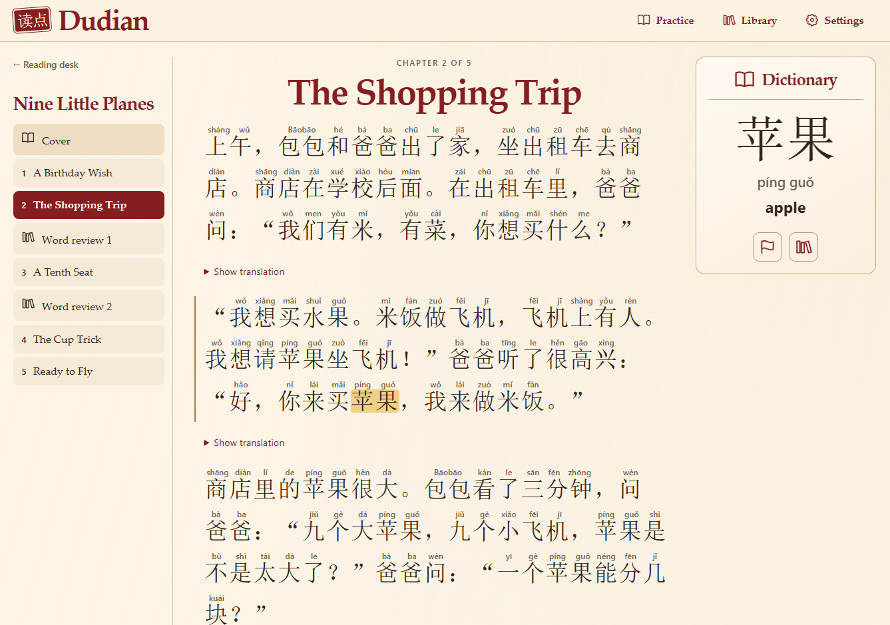

<h1 align="center">
  
</h1>

I built Dudian to improve my Chinese. It’s a small app I vibe-coded between other projects to get a reading routine that works for me. I read short stories about Baobao, tap unfamiliar words for their meanings, and practice them again later.


## Run with Docker

With Git and Docker Compose installed, run:

```sh
git clone https://github.com/TimHoogervorst/Dudian.git
cd Dudian
# Set ADMIN_PASSWORD in the environment or the local .env file.
docker compose up -d --build
```

Open [Dudian](http://localhost:3000) and create an account with a username and password. Sign in with the same account on another device to resume reading. All learners share the story catalog. Bookmarks, word strength, practice sessions, and reading history belong to each account. The private admin center handles catalog generation.

Open [Admin center](http://127.0.0.1:3001) and sign in with `ADMIN_USERNAME` (default `admin`) and `ADMIN_PASSWORD`. The admin service requires a password to start. For remote access, forward the admin and provider sign-in ports on your workstation:

```sh
ssh -N -L 3001:127.0.0.1:3001 -L 14551:127.0.0.1:14551 user@docker-host
```

Point the public HTTPS proxy at the reader on port 3000. In Admin Settings, connect the AI provider for both apps. An existing installation reuses its saved connection. Use **Stories** to inspect suggestions, choose an audience, and publish a new reading. [Connection and cover artwork setup](docs/chatgpt-connection.md)

To stop the app, run `docker compose down`. PostgreSQL keeps stories and progress in the `postgres-data` volume. The `reader-data` volume holds the host’s provider connection.

## Development

The reader uses `public/` and `src/server.ts`. The private admin service uses `admin/` and `src/admin/server.ts` and processes catalog generation jobs. Compose keeps the database on its internal network. For native development, set `DATABASE_URL` to a PostgreSQL database whose setup user can create the tables and the `dudian_learner` role.

Run `npm ci` and `npm run typecheck`. Set `TEST_DATABASE_URL` to a PostgreSQL test database and run `npm test`. Integration tests create and remove isolated schemas.

## Inside the reader

Tap a word like 苹果 to see its meaning, or reveal the English translation beneath a paragraph.



## License

Copyright (c) Street Talk contributors. Dudian’s original application code is licensed under the [GNU Affero General Public License, version 3 only](LICENSE) (`AGPL-3.0-only`).

Bundled dictionary and curriculum data carry their own licenses. The application license excludes the supplied design references and illustrations. [Dictionary and vocabulary credits](data/NOTICE.md)
