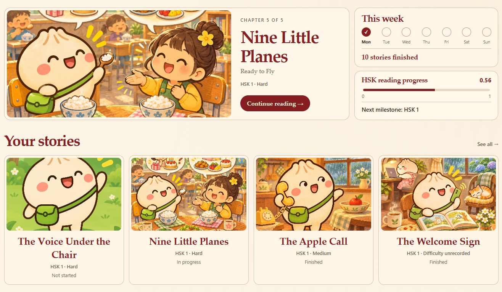

<h1 align="center">
  
</h1>

I built Dudian to improve my Chinese. It’s a small app I vibe-coded between other projects to get a reading routine that works for me. I read short stories about Baobao, tap unfamiliar words for their meanings, and practice them again later.



## Run with Docker

With Git and Docker Compose installed, run:

```sh
git clone https://github.com/TimHoogervorst/Dudian.git
cd Dudian
docker compose up -d --build
```

Open [Dudian](http://localhost:3000) and create an account with a username and password. Sign in with the same account on another device to resume reading. All learners share the story catalog. Bookmarks, word strength, practice sessions, and reading history belong to each account. To enable generation, connect the host from **Settings → Continue with ChatGPT**. Each request uses its learner’s selected focus and waits in the generation queue. [Connection and cover artwork setup](docs/chatgpt-connection.md)

To stop the app, run `docker compose down`. PostgreSQL keeps stories and progress in the `postgres-data` volume. The `reader-data` volume holds the host’s provider connection.

## Development

The browser UI lives in `public/`. The TypeScript HTTP server in `src/` authenticates requests, accesses PostgreSQL, and processes generation jobs. Compose keeps the database on its internal network. For native development, set `DATABASE_URL` to a PostgreSQL database whose setup user can create the tables and the `dudian_learner` role.

Run `npm ci` and `npm run typecheck`. Set `TEST_DATABASE_URL` to a PostgreSQL test database and run `npm test`. Integration tests create and remove isolated schemas.

## Inside the reader

Tap a word like 苹果 to see its meaning, or reveal the English translation beneath a paragraph.


[MIT license](LICENSE) · [Dictionary and vocabulary credits](data/NOTICE.md)
